# Candidate Intake and Police Assignment Architecture

**Status:** Contains project-owner-approved policy slices dated 2026-11-22 and separate implementation recommendations that remain proposals. Approval does not grant runtime permissions or change existing OAD statuses.
**Scope:** Securely materialize `AccidentCandidate` records from accepted AI observations, bind candidates to the relevant Police organization, assign a specific reviewer, and preserve the approved review outcomes. Hospital response and ambulance dispatch are outside this design.

## Recommendation Summary

1. **APPROVED (2026-11-22):** The backend creates `AccidentCandidate` records from eligible `DetectionEvent`s. AI cannot independently verify accidents or select reviewers. The event eligibility predicate remains unresolved. Keep AI submission limited to event data.
2. **PROPOSED:** Create at most one candidate per eligible event and do not merge distinct event IDs automatically. This uses existing exact-event identity controls but does not prevent multiple IDs from representing one accident; project-owner approval of this boundary is still required.
3. **APPROVED (2026-11-22):** Each authorized source has exactly one designated active Police organization, and the backend determines the candidate route. Missing, inactive, or non-unique routing fails closed. An explicit route record is a recommended implementation, not a separately approved schema.
4. **APPROVED (2026-11-22):** An authorized user in the existing `ADMIN` group with active Police membership in the candidate's assigned Police organization may assign the candidate to an active Police reviewer belonging to that same organization. This is organization-scoped authority, not global Admin access. Assignment cardinality and reassignment details remain unresolved.
5. The 2026-11-21 approval of `FURTHER_REVIEW` remains in force: it creates no incident and preserves the candidate for subsequent review. Returning it to `RECEIVED`, retaining the same reviewer, and the review-history representation remain proposals requiring approval.
6. Keep candidate and review routes fail-closed until the approved policies have server-side enforcement and the separate security and lifecycle dependencies are resolved and verified.

## Existing Code and Reusable Controls

| Area | Existing implementation | Architectural consequence |
|---|---|---|
| Machine authentication | [`AIServiceAuthentication`](../../../backend/api/v1/authentication.py) delegates to the configured `AI_SERVICE_AUTHENTICATOR`; [`base.py`](../../../backend/config/settings/base.py) sets it to `None`. The test authenticator is testing-only. | The production submission route currently fails closed. A machine-authentication mechanism and source-level scope must be approved and configured before intake is enabled. |
| Detection submission | [`DetectionEventSubmissionView`](../../../backend/api/v1/views.py) accepts a `video_source_id` and event metadata, then calls the ingestion service. It does not create a candidate. | Keep the AI API boundary event-only. Do not add Police organization, reviewer, or candidate decision fields to this request. |
| Event validation and replay | [`ingest_detection_event`](../../../backend/apps/detection/services/ingestion.py) validates event provenance, locks the source, requires an authorized and available source, and uses `(video_source, external_event_id)` plus semantic payload matching for idempotency. Same-key/same-content requests replay; changed content conflicts. | Reuse for exact event replay and source authorization. The current `MachineActor` identifies `AI_SERVICE` generally and does not itself restrict the service to a source allowlist. |
| Event and candidate | [`DetectionEvent`](../../../backend/apps/detection/models.py) supports `OBSERVATION` and `UNCERTAIN`. [`CandidateDetectionEvent`](../../../backend/apps/incidents/models.py) allows each event to be linked to at most one candidate. | Reuse provenance and the uniqueness guard. Distinct event IDs may still describe the same real-world accident; no similarity or cross-source deduplication exists. |
| Candidate materialization | [`create_candidate`](../../../backend/apps/incidents/services/candidates.py) requires an explicit event, checks the source authorization state, locks the event, returns an existing candidate for a linked event, and creates a `RECEIVED` candidate with an event link. Its machine path checks `AI_SERVICE` identity but does not call the injected `candidate.create` policy. There is no public candidate creation route. | Backend candidate creation from eligible events is approved (2026-11-22), but the eligible-event predicate is not. Implement a policy-enforced materializer; do not expose the current machine path as-is. |
| Organization scope | [`OrganizationMembership`](../../../backend/apps/organizations/models.py) represents active/suspended/revoked membership and enforces `POLICE` membership against a `POLICE` organization. [`VideoSource`](../../../backend/apps/sources/models.py) has an optional source-owner organization. | The per-source active Police route and backend-determined routing rule are approved (2026-11-22). Source ownership does not establish Police jurisdiction. No route record or candidate-to-organization/reviewer relation exists; missing, inactive, or non-unique routing must fail closed. |
| Review and incident | [`CandidateReview`](../../../backend/apps/incidents/models.py) supports one final `VERIFIED` or `REJECTED` decision. [`_review_candidate`](../../../backend/apps/incidents/services/candidates.py) locks the candidate and creates the review, candidate status, one `OPEN` incident and initial history atomically for `VERIFIED`. Unique constraints and command IDs protect finalization. | The verified path is reusable. `FURTHER_REVIEW` cannot be stored, and the current unique final review relation cannot represent multiple review cycles. |
| Candidate API and audit | Candidate views are unavailable and [`HasCandidateReviewPermission`](../../../backend/api/v1/permissions.py) denies. [`audit/events.py`](../../../backend/apps/audit/services/events.py) allow-lists candidate create/start/verify/reject actions, but not assignment or further-review actions. | Keep API access blocked. Add approved assignment and non-final-decision audit coverage before enabling the workflow. |

The [Police Candidate Review Architecture Blueprint](police_candidate_review_architecture_blueprint.md) and [authorization matrix](../security/authorization_matrix.md) describe the approved access boundary. The proposed data associations below fill gaps those documents identify; they do not replace the approved rule that review is limited to the assigned reviewer with active membership in the assigned Police organization.

## Proposed End-to-End Flow

```mermaid
flowchart LR
    AI[AI service] -->|authenticated event only| API[Detection submission API]
    API --> AUTH[Machine identity and source scope]
    AUTH --> ING[Validate and persist event]
    ING --> EV[(DetectionEvent)]
    EV --> MAT[Backend candidate materializer]
    MAT --> ELIG[Approved intake eligibility]
    MAT --> ROUTE[Explicit source to Police route]
    ELIG --> CAND[(AccidentCandidate)]
    ROUTE --> CAND
    EV --> LINK[(CandidateDetectionEvent)]
    CAND --> ASSIGN[Police assignment authority]
    ASSIGN --> REVIEWER[One current assigned reviewer]
    REVIEWER --> DECIDE{Human decision}
    DECIDE -->|FURTHER_REVIEW| CAND
    DECIDE -->|REJECTED| AUDIT[(AuditEvent)]
    DECIDE -->|VERIFIED| TX[Atomic verification service]
    TX --> INC[(One OPEN AccidentIncident)]
    TX --> AUDIT
    ASSIGN --> AUDIT
```

1. **Authenticate the sender.** The submission API accepts a dedicated machine identity, not a human JWT. The recommended credential is short-lived OAuth 2.0 client credentials from the deployed identity provider, scoped to event submission. Bind that identity to the source(s) it may submit for. If the deployment has no suitable issuer, security review must select and document an alternative such as mutual TLS before implementation. The current adapter is only a verifier hook; it does not provide credentials, rotation, source grants, or replay protection by itself.
2. **Persist the observation.** Validate the source ID against the machine's allowed source scope and the authorized/available `VideoSource` registry. Preserve the existing `(source, external_event_id)` identity and semantic replay check. Reject a changed payload under an existing key. Event submission never accepts a candidate ID, Police organization ID, reviewer ID, or verification outcome.
3. **Materialize through a backend operation.** The approved policy is for the backend to create candidates from eligible events. The materializer must enforce the still-to-be-defined eligibility predicate, verify source authorization, and resolve the source's single designated active Police organization. It must create the candidate and provenance link without allowing AI to choose the organization, reviewer, or decision. A candidate is not an accident finding. Production AI authentication remains a separate prerequisite.
4. **Fail closed on unavailable routing.** If the source has no designated route, its route is inactive, or the backend cannot resolve exactly one active Police organization, do not create or assign a candidate and do not guess a fallback. Handling an already accepted event for later reconciliation is a separate implementation detail; it does not weaken this routing gate.
5. **Assign a reviewer.** An authorized assigner chooses a target who is active and has active `POLICE` membership in the candidate's bound organization. Store the current assignment and append assignment history. Candidate organization binding is immutable once a reviewer assignment exists; a jurisdiction correction requires an audited correction process and must not silently move an active review.
6. **Enforce access on every request.** The API derives the human from the authenticated session. Queue selection filters to the caller's active assignment and active membership in the exact candidate organization. Detail, review-start, decision, and permitted-field reads re-check both conditions server-side. A group-only or organization-wide queue is not allowed. Out-of-scope candidate IDs should be concealed with not-found behavior after the policy is configured.
7. **Record the human outcome.** Only the assigned human Police reviewer may record `VERIFIED`, `REJECTED`, or `FURTHER_REVIEW`. AI confidence and event type remain evidence only. Reuse the existing atomic `VERIFIED` transaction. `REJECTED` creates no incident. `FURTHER_REVIEW` creates no incident and reopens the candidate for another review cycle as described below.

## Police Organization and Reviewer Assignment

### Candidate organization binding

**Approved policy (2026-11-22):** Each authorized video source has exactly one designated active Police organization, and the backend determines candidate routing. Missing, inactive, or non-unique routing fails closed for candidate materialization.

An explicit server-managed route record from `VideoSource` to the Police organization is the recommended representation, not an owner-approved schema choice. Recording the route reference used for a candidate would prevent later route changes from silently rewriting its jurisdiction; this is also an implementation recommendation to confirm during technical design.

Do not infer the route from `VideoSource.owner_organization`: that field identifies the source owner, which can be a `SOURCE_OWNER` or another organization and is not necessarily the Police jurisdiction. Do not accept a Police organization from the AI payload. Do not choose by confidence, coordinates, or another heuristic. If exactly one active route is unavailable, fail closed.

The project-owner approval establishes the routing invariant and backend decision point; it does not specify which existing authority configures or corrects route data, how changes are audited, or the route's persistence model. Do not infer that source registration or authorization automatically grants route-maintenance authority. Resolve these details before enabling route configuration.

### Assignment authority

There is no current candidate assignment model, service, route, or candidate-specific permission policy.

**Approved authority rule (2026-11-22):** An authorized user in the existing `ADMIN` group with active Police membership in the candidate's assigned Police organization may assign the candidate to an active Police reviewer belonging to that same organization. Enforce the same-organization and active-membership conditions server-side. `ADMIN` membership alone does not grant assignment authority or global candidate access; no new human role is introduced.

The target reviewer receives no candidate access until a current assignment exists; the assigner's authority does not itself grant review access. Django `is_staff` or `is_superuser` status does not replace the approved group, organization, and assignment checks.

Represent reviewer assignment separately from `CandidateDetectionEvent` (provenance) and `ResponseAssignment` (incident response). At most one current reviewer per candidate, the representation/history schema, and any reassignment authority remain design decisions. Assignment and audit writes must be atomic once their approved contract is implemented.

The approved authority rule does not enable the blocked assignment route. Implement its exact organization and target checks without substituting global Admin access or creating a new human role.

## `FURTHER_REVIEW` Runtime Semantics

Recommend treating `FURTHER_REVIEW` as a non-final review attempt:

- Append the outcome, reviewer, command ID, timestamp, and any optional rationale to an append-only review history. Preserve the invariant of at most one final `VERIFIED` or `REJECTED` decision per candidate. A suitable implementation is to extend the review ledger to all three outcomes and make uniqueness conditional on a final outcome; this needs a model/migration change in a later implementation task.
- Within the same transaction, move the candidate from `UNDER_REVIEW` back to `RECEIVED`. This makes it available for a subsequent assigned review using the existing queue statuses while preserving a clear decision history.
- Retain the current reviewer assignment for the next review cycle. Do not automatically select or notify another reviewer. If a different reviewer is needed, use an explicit authorized assignment command with its own history and audit record; the approval boundary for reassignment must be recorded first.
- Create no `AccidentIncident`, no incident history, and no Hospital response record.
- Enforce command idempotency across retries. A repeated command with the same intent returns the recorded outcome; a reused command ID with different intent fails. Candidate locking must serialize concurrent FURTHER_REVIEW and final-decision attempts.

The owner-approved meaning already requires no incident and preservation for subsequent review. Returning to `RECEIVED`, keeping the same reviewer, and the proposed review-history representation are implementation recommendations that still need approval. No new mandatory rationale requirement is implied; the current nonblank rejection rationale behavior remains as-is unless separately changed by approval.

## Authorization, Duplicate Prevention, Audit, and Failure Handling

### Authorization checks

- AI event submission: valid dedicated machine principal; permitted source scope; source currently authorized and available. A valid AI principal has no candidate decision, reviewer assignment, incident write, or human read permission.
- Candidate materialization: trusted backend operation; event exists and has not been associated; approved event eligibility; unique Police route; route target is active and `POLICE`; source remains authorized. Apply an explicit authorization policy to the machine path rather than relying on `require_ai_service` alone.
- Assignment: active authorized assigner in the exact candidate Police organization; target reviewer is active and has active Police membership in that organization; candidate is assignable; request command is idempotent.
- Review/read: active human; current candidate assignment points to that user; active Police membership matches the candidate's bound organization; candidate state permits the operation. Recheck on each request, including a list query.

### Duplicate and concurrency boundaries

- **Same event replay:** Existing source/event uniqueness and semantic payload digest are suitable. Same content replays; changed content conflicts.
- **Same event materialized twice:** Existing unique `CandidateDetectionEvent.detection_event` plus candidate-row/event locking can guarantee at most one linked candidate per event. Retain the uniqueness constraint as the final guard.
- **Different event IDs for one accident:** Not prevented by current code. The proposal is one candidate per eligible event and no silent merge. The owner must approve that limitation or define a source/time/space grouping and duplicate review process before broad automatic materialization. Do not claim real-world duplicate prevention from the existing database constraint.
- **Concurrent assignment/review:** Lock the candidate and current assignment in one transaction, verify current membership and target at commit time, and constrain one current assignment. Use command IDs to distinguish retry from conflicting intent.
- **Verified incident:** Keep the existing candidate lock, unique candidate-to-incident constraint, unique final review, and single transaction that records the final review and creates one `OPEN` incident plus its initial history.

### Audit requirements

Reuse the append-oriented audit service and its safe-context allowlist. Add explicit actions for candidate-to-Police binding/materialization, reviewer assignment/reassignment, and `FURTHER_REVIEW`. Include stable IDs for candidate, source/event, organization, reviewer/assigner, command, decision, and incident where applicable; never copy raw request payloads, credentials, evidence, or rationale into audit context. Persist state changes and success audit events in the same transaction. Record authorization denials and materialization deferrals with safe reason codes; do not reveal candidate existence to unauthorized callers.

Current audit already covers detection acceptance/replay, candidate creation, review start, verified/rejected outcomes, and the verified incident ID. It does not cover candidate assignment, Police routing, or `FURTHER_REVIEW`. The audit service's action/context allowlist must be extended in the future implementation; no runtime change is made by this proposal.

### Failure behavior

| Condition | Recommended behavior |
|---|---|
| Machine authenticator missing or invalid | Fail closed; create no event or candidate. Keep the current unavailable behavior until an approved verifier is configured. |
| Source is unknown, unauthorized, unavailable, or outside the machine's source grant | Reject intake and record a safe denial. Create no candidate. |
| Same event key with changed semantic payload | Return an idempotency conflict; do not overwrite the accepted event or candidate. |
| Candidate eligibility or Police route is missing/ambiguous | Persist the accepted event only; do not create an unassigned candidate. Make it reconcilable after an authorized correction, with a safe deferral audit record. |
| Candidate/link/binding/audit transaction fails | Roll back the materialization transaction. Leave the already accepted event available for idempotent retry/reconciliation. |
| Reviewer or assigner has lost account/membership/authority | Deny the command and preserve the current assignment and review state. Revoke access immediately when membership or assignment is no longer active. |
| Concurrent final decisions or command conflict | Serialize on the candidate, return the recorded result for an exact retry, and reject conflicting intent. Never create a second incident. |

For recovery, recommend an idempotent backend reconciliation operation that selects accepted events without a `CandidateDetectionEvent` link, rechecks source authorization, intake eligibility, and the current approved Police route, then materializes only events that pass all checks. Invoke it after successful event acceptance and after an authorized route correction; any scheduled retry mechanism remains subject to the existing background-processing decision OAD-011. Until reconciliation exists, an accepted event must not be represented to the caller as a created candidate.

## Remaining Project-Owner Decisions and Dependencies

The 2026-11-22 addendum in the [domain governance decision register](../decisions/domain_governance_decision_register.md) approves the backend candidate-creation principle, Police-routing invariant, and organization-scoped assignment authority. The following details remain proposals or security/implementation dependencies. Record any later policy choices as dated addenda under existing OAD identifiers; do not create duplicate OADs or change unrelated statuses.

| Existing OAD | Decision requiring approval | Recommendation | Why suitable |
|---|---|---|---|
| OAD-017, with OAD-008 | Production AI authentication and source scope | Prefer short-lived OAuth 2.0 client credentials from a supported issuer, constrained to event submission and approved source IDs; use another reviewed mechanism if deployment topology cannot support it. | Mechanism, credential lifecycle, source grants, transport, and replay controls remain unapproved. This is a separate security dependency; candidate-creation approval does not configure machine authentication. |
| OAD-005 / OAD-015 | Eligible event outcomes, event-to-candidate cardinality, and cross-event duplicates | Consider both accepted `OBSERVATION` and `UNCERTAIN` events eligible; create one candidate per eligible event and do not automatically merge distinct IDs. | The owner approved candidate creation from eligible events, but did not define eligibility or approve this grouping/duplicate limitation. |
| OAD-019 / OAD-012 | Route-data maintenance and correction authority | Determine which existing authority configures and corrects each source's designated Police organization and how changes are governed. | The exactly-one-active-route invariant and backend routing are approved; the maintenance actor, change process, and persistence representation were not specified. |
| OAD-012 | Assignment cardinality and reassignment | Consider one current reviewer per candidate, with any reassignment performed by an explicit authorized and audited command. | The assigner and target scope are approved. One-current-assignee cardinality and later reassignment authority are not. |
| OAD-012 / OAD-015 | `FURTHER_REVIEW` lifecycle | Consider non-final review history, return to `RECEIVED`, retention of the current reviewer, and a subsequent review cycle with no incident. | The outcome and preservation/no-incident meaning were approved on 2026-11-21; these state, history, and reviewer-retention details remain proposals. |

Security review is required for machine credential verification, rotation, source grants, and replay controls. Police operational representatives should validate route-data maintenance and technical implementation. Until remaining policy details are settled and the approved controls are implemented and verified, leave candidate APIs unavailable and runtime permissions unchanged.

## Candidate Intake and Assignment Entry Gates

Candidate verification remains **not ready for privileged end-to-end implementation**. The approved candidate-creation, Police-routing, and reviewer-assignment rules are policy baselines, not working controls. Before enabling any route, resolve production machine authentication and source grants, eligible-event and duplicate rules, route-data maintenance, and the detailed `FURTHER_REVIEW` lifecycle. Then implement the assignment/routing records, server-side authorization, API contract, audit actions, Flutter contract, and acceptance criteria. Hospital notification and ambulance dispatch remain outside this scope.
