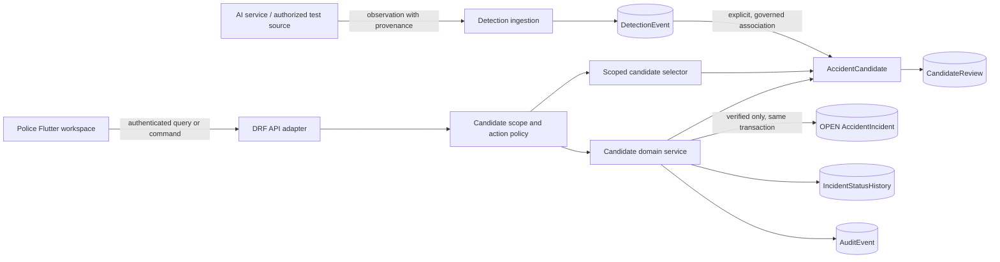
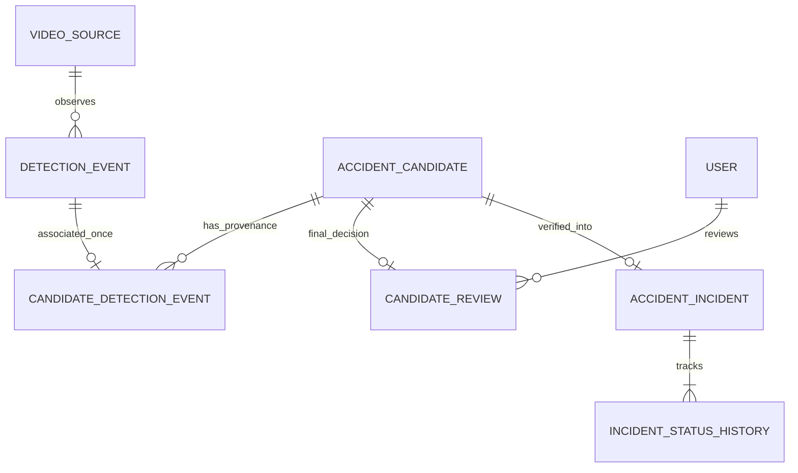

# Police Accident Review and Verification Architecture Blueprint

**Design status:** Owner-approved candidate-review policy with an implemented assigned-review workflow. The runtime now supports assigned candidate reads, review start, `VERIFIED`, and `REJECTED`. `FURTHER_REVIEW`, production AI intake, evidence/location access, and Hospital/dispatch workflows remain unavailable.

**Scope:** Candidate intake and assignment where governed, assignment-scoped Police listing/review, the three approved decision outcomes, atomic creation of one authoritative `OPEN` incident after verification, auditability, and Flutter integration. Hospital notification/request creation, acknowledgement, ambulance dispatch/status, external agency communication, and real emergency response are outside candidate review.

**Evidence convention:** **Approved** means explicitly approved by the project owner. The Police-first simulated response workflow was approved on 2026-11-19; the candidate access, assignment, decision, incident, and audit policy below was approved on 2026-11-21. **Existing** describes code/database behavior. **Unresolved** requires a recorded decision before the related capability is enabled. Existing code is not evidence of approval.

## Executive Summary

The project owner approved assignment-scoped Police review: only the specifically assigned and authorized human Police reviewer with active membership in the candidate's assigned Police organization may review that candidate. `VERIFIED` creates exactly one linked `OPEN` incident atomically; `REJECTED` creates none. `FURTHER_REVIEW` remains unavailable until its persistence and subsequent-review lifecycle are approved. AI detection never establishes an accident. Assignment, review, decisions, and incident creation have traceable audit records.

The implemented runtime binds candidates to a Police organization, records one immutable reviewer assignment, scopes list/detail to the assigned active reviewer, and rechecks account, organization, membership, assignment, and state for review commands. Authenticated APIs expose review start, verification, and rejection. Flutter provides the assigned-candidate queue and detail actions using only the existing summary fields. Verification and incident creation remain one database transaction. No database migration was needed.

Production AI ingestion, evidence/location access, event-to-candidate materialization, `FURTHER_REVIEW`, Hospital notification, response assignment, dispatch, and external emergency-service contact remain outside the enabled workflow. The architecture assessment and sequence below retain design rationale recorded before implementation; the implementation status in this summary supersedes earlier statements that candidate review was blocked.

**Readiness verdict:** The approved assigned-review workflow is implemented. Remaining independent governance/infrastructure boundaries stay fail-closed. See [implementation readiness](implementation_readiness.md).

Candidate review ends with creation of the authoritative incident. Hospital request/notification, acknowledgement, dispatch simulation/status, and all real emergency-service contact are outside this scope, even though a simulated response workflow was separately approved on 2026-11-19.

## Current Architecture Assessment

| Area | Existing implementation | Candidate-review assessment |
|---|---|---|
| Backend | Django REST Framework API adapters, domain services, policy hooks, selectors, serializers, and centralized v1 routes. | Keep orchestration in API views and domain rules in services. Candidate routes are present as fail-closed placeholders. |
| Persistence | Django models and migrations target PostgreSQL. Candidate, review, incident, history, and event links have foreign keys, checks, and uniqueness constraints. | Current verification cardinality and transaction design fit one final decision and one incident per candidate. Assignment ownership and non-final review-attempt history are not represented. |
| Identity | Human JWT authentication resolves an active Django user. Machine actor identity is separate. Organization membership is a separate record from role groups. | Human identity and Police group membership are not sufficient candidate authority. AI_SERVICE is never a reviewer. |
| Existing incident authorization | Enabled incident reads are filtered through active target-organization membership and assignment scope. Selected assignment commands recheck target membership and state. Admin has no implicit global bypass. | Reuse these patterns, but do not reuse incident-assignment scope as candidate-review scope without an approved candidate policy. |
| Candidate authorization | The assigned-review API uses a scoped candidate selector and `AssignedCandidateReviewPolicy`; review services fail closed without that policy and recheck active reviewer and membership under row locks. | Only the assigned reviewer with active membership in the candidate's active Police organization can read or review. `FURTHER_REVIEW` and unrelated candidate operations remain unavailable. |
| AI and candidate intake | Detection ingestion stores an idempotent `DetectionEvent`. Candidate creation/association exists as a separate service. Ingestion does not automatically create or group candidates. Machine authentication and source authorization are not configured for a usable API workflow. The machine candidate-creation path does not invoke the candidate creation policy. | Resolve authorized/synthetic intake, machine authentication, source policy, candidate materialization, and duplicate protection before exposing intake. Do not infer every event becomes a candidate or group similar events. |
| Flutter | Shared authenticated client plus a Police-only candidate review tab, assigned-candidate list, detail, review start, verification, and rejection controls. | Candidate actions use authenticated APIs and display only summary identifiers, status, and timestamps. Evidence and location remain hidden. |
| External response | Response assignment and simulated notification concepts exist; creation/routing and several operations remain blocked. | Outside this blueprint's implementation scope. An `OPEN` incident alone does not create a Hospital request. |

The repository marks architecture and governance materials as revised drafts pending broader approval. The project-owner approvals of 2026-11-19 and 2026-11-21 settle the later simulated response sequence and the candidate-review policy boundaries respectively, but they do not enable any blocked route. See [governance overview](governance_overview.md), [candidate policy](candidate_review_verification_policy.md), [workflow approval record](accident_verification_emergency_response_workflow.md), and [domain decision register](../decisions/domain_governance_decision_register.md).

## Existing Domain Capabilities

| Capability | Existing behavior | Reuse / limitation |
|---|---|---|
| Detection event | `DetectionEvent` records source, external event identity, service principal, model/version, detection/receipt time, outcome, optional confidence/digest, and metadata. `(video_source, external_event_id)` is unique. | Reuse provenance and duplicate-event protection. Detection is an observation, not verification. |
| Candidate | `AccidentCandidate` has `RECEIVED`, `UNDER_REVIEW`, `VERIFIED`, or `REJECTED` status, Police organization binding, and creation/update timestamps. `CandidateReviewerAssignment` stores its one append-only reviewer assignment. | Reuse the aggregate and assignment record. Reassignment and candidate status-history are not implemented. |
| Event association | `CandidateDetectionEvent` associates an event and candidate, records method, optional linking user, and time. An event can be linked to at most one candidate. | Reuse the explicit association. Similar-event grouping and candidate merging are not implemented or approved. |
| Review decision | `CandidateReview` stores one final `VERIFIED` or `REJECTED` decision, reviewer, rationale, timestamp, and optional command ID. It is append-only. One final review per candidate and one use of each non-null command ID are constrained. Rejection rationale is required; verification rationale is nullable. | Reuse the verified/rejected path. It does not model `FURTHER_REVIEW`, assignment, or a non-final review attempt. |
| Incident | `AccidentIncident` is linked to a candidate with a unique constraint and has `OPEN`, `RESPONSE_ACTIVE`, `RESOLVED`, or `CLOSED` status. | Reuse the existing authoritative record. No incident is created for an unverified/rejected candidate. |
| History and audit | `IncidentStatusHistory` records the initial `OPEN` state. `AuditEvent` records assignment, review start, verified/rejected decisions, and safe success/denial context through an allow-listed service. | Available review actions have traceable audit. `FURTHER_REVIEW` is unavailable; audit retention, reader access, and integrity governance remain open. |
| Domain commands | Candidate create/associate, reviewer assignment, assigned queue/detail selectors, review start, verify, and reject functions exist in `backend/apps/incidents/services/`. | Review start, verify, and reject are exposed through authenticated APIs. Candidate create/associate remain separate from production event ingestion and unavailable as public API operations. |

Current `create_candidate` takes an explicitly selected event and does not implement similarity heuristics. The AI ingestion route only accepts and stores an event; it does not create a candidate. These are separate operations today. There is no public candidate-creation operation: the candidate collection API is limited to assigned reviewer reads. The assignment API and review start/verify/reject APIs are authenticated and organization-scoped. An approved actor/source policy and grouping rule remain prerequisites for production intake.

## Target System Architecture

The API adapter authenticates the caller, validates request shape, obtains the actor from the authenticated principal, delegates access filtering or a command to the backend, and maps results/errors to a versioned response. Candidate scope and permission policy must be checked server-side on every request. The service owns state-transition validation, locking, transaction boundaries, idempotency, domain records, and successful audit. Serializers validate syntax and bounded input only; they do not grant authority or decide transitions. Flutter renders backend results and never creates the incident or locally decides whether a candidate is verified.

Do not add a duplicate review or incident service. Add a reviewer-assignment model or candidate history only if the approved policy requires a capability that the current records cannot safely represent.

## Domain Responsibility and Entity Relationships

| Entity | Responsibility | Relationship and authority boundary |
|---|---|---|
| `DetectionEvent` | Immutable-enough record of what an authorized detector observed and its provenance. | Belongs to a `VideoSource`; can be associated with at most one candidate. Its confidence or `OBSERVATION`/`UNCERTAIN` outcome cannot establish a real accident. |
| `AccidentCandidate` | Review subject representing a possible accident. Owns the queryable candidate lifecycle status. | May have `CandidateDetectionEvent` links; review start/final decision services require at least one. Candidate status is not an incident status and does not imply Police assignment. |
| `CandidateReview` | The single final human decision on the current model. | References candidate and human reviewer. `VERIFIED` or `REJECTED`; append-only and unique per candidate. It is not an assignment record or a non-final review note. |
| `AccidentIncident` | Authoritative operational incident after successful Police verification. | References exactly one candidate; current database uniqueness allows at most one incident per candidate. Initial status is `OPEN`. |
| `IncidentStatusHistory` | Records incident status transitions. | References an incident; initial row is `None → OPEN` attributed to the verifier and command. Candidate review history is separate. |
| `AuditEvent` | Trace of consequential operations and safe denials. | Records actor, action, target, time/outcome and allow-listed context. It must not contain evidence bytes, secrets, or unrestricted rationale/media. |
| `OrganizationMembership` | Current relationship between a human account and an organization, with a role group and active/suspended/revoked state. | Establishes organization membership, not candidate jurisdiction, reviewer designation, or review assignment. |

The diagram shows persisted relationships and the assigned-reviewer policy. Candidate organization binding and the one-to-one reviewer assignment are persisted. `CandidateReview` depicts only current final outcomes; `FURTHER_REVIEW` is not modeled. `UNDER_REVIEW` alone does not identify a reviewer, so each operation still checks the immutable assignment.

## Police Review Workflow

1. An authorized or synthetic test source supplies an input. The AI service may produce a `DetectionEvent` with source/model provenance; intake is an observation, never proof of an accident.
2. The backend creates or explicitly associates an `AccidentCandidate` under an approved intake rule. Ingestion does not do this automatically, and there is no public candidate-creation operation. Actor, AI authentication, materialization, grouping, and duplicate-submission policy remain unresolved; do not expose an arbitrary client-controlled association.
3. An explicitly authorized authority within the relevant Police organization assigns the candidate. The exact existing backend permission/mechanism and candidate-to-organization/reviewer representation remain unresolved; do not assume a global Admin or introduce a new role.
4. Only the specifically assigned and authorized human Police reviewer with active membership in the candidate's assigned Police organization may access that assigned candidate. Recheck membership, assignment, and action policy on every queue/detail/review request; group membership alone is insufficient.
5. The assigned reviewer records one of the approved outcomes: `VERIFIED`, `REJECTED`, or `FURTHER_REVIEW`. AI confidence remains contextual evidence only.
6. On `VERIFIED`, atomically record the decision and candidate state, exactly one linked `OPEN` incident, initial incident history, and success audit.
7. On `REJECTED`, record the decision and candidate state/audit, and create no incident.
8. On `FURTHER_REVIEW`, record the outcome, create no incident, and preserve the candidate for subsequent review. The current model/service cannot represent this outcome or proceed from an already `UNDER_REVIEW` state to a subsequent review; implement support without inventing new business meaning.

## Candidate Lifecycle and State Transitions

| Transition | Current service behavior | Governance status and target rule |
|---|---|---|
| New → `RECEIVED` | Candidate creation creates `RECEIVED`; event association is explicit. | Existing code. Event-to-candidate intake/grouping remains unresolved under OAD-015/017/019. |
| Assignment to reviewer | One append-only `CandidateReviewerAssignment` per candidate, created through an organization-scoped command and authenticated API. | The existing authority mechanism requires the `ADMIN` group and active Police membership in the candidate organization; reassignment is not available. |
| `RECEIVED` → `UNDER_REVIEW` | `begin_candidate_review` locks the active reviewer and candidate, requires event provenance, checks assigned-reviewer and active Police membership policy, updates status, and audits. | Implemented at `POST /candidates/{id}/review/`. |
| `UNDER_REVIEW` → `VERIFIED` | `verify_candidate` records final review, updates candidate, creates one `OPEN` incident/history and audit atomically. | Implemented at `POST /candidates/{id}/verify/`; command replay returns the existing incident. |
| `UNDER_REVIEW` → `REJECTED` | `reject_candidate` requires nonblank rationale, writes final review/status/audit, and creates no incident. | Implemented at `POST /candidates/{id}/reject/`; existing rationale validation is preserved. |
| `UNDER_REVIEW` → `FURTHER_REVIEW` → subsequent review | No command or persisted non-final outcome exists; `begin_candidate_review` rejects candidates already `UNDER_REVIEW`. | Not available. Detailed persistence and re-entry policy remain unresolved. |
| Final → reopened, dismissed, needs evidence, or merged | Not implemented. | Outside the approved scope. Do not add without an explicit decision on actor, state, audit, correction, visibility, retention, and incident impact. |

`VERIFIED` and `REJECTED` are terminal in the current model; `FURTHER_REVIEW` is not modeled. A candidate must have associated event provenance before review or final decision. The approved candidate assignment does not imply access to evidence/media/location. Define permitted fields before enabling detail responses, and keep those separate domains gated.

## Authorization and Assignment Architecture

Authorization has four separate questions: **who is the principal**, **which organization membership is active**, **which candidate is in scope**, and **which action is granted**. A `POLICE` group label answers none of the final three by itself.

| Operation | Required authority shape | Existing protection / gap |
|---|---|---|
| Assign candidate/reviewer | Existing `ADMIN` group member with active membership in the candidate's active Police organization; reviewer is an active Police member in the same organization. | Implemented by the one-time append-only assignment command and authenticated API; no global Admin bypass or reassignment. |
| List queue | Active human Police reviewer, active membership in the candidate's assigned Police organization, and assignment to that candidate. Apply full scope before pagination. | `visible_candidate_queryset` enforces scope before pagination. |
| Read detail | Same assigned reviewer/resource scope, with active membership rechecked; only approved fields. | Candidate summary API returns identifiers, status, and timestamps; evidence/location remain separately blocked. |
| Start review | Same assigned reviewer scope; eligible state and event provenance. | Service and API check assignment and current Police scope under transaction and row locks. |
| `VERIFIED` / `REJECTED` | Same assigned human Police reviewer scope. Verification creates exactly one incident; rejection creates none. | Existing domain commands are exposed through separate authenticated APIs and recheck reviewer scope and candidate state. Rejection rationale remains required. |
| `FURTHER_REVIEW` | Same assigned human Police reviewer scope; preserve candidate, create no incident, permit subsequent review. | No command, decision value, non-final record, or subsequent-review path exists. |

**Organization scope:** The approved scope is active membership in the Police organization to which the candidate is assigned, plus the assigned-candidate relationship. `AccidentCandidate.police_organization` and its one-to-one reviewer assignment represent that scope. A source owner is not assumed to be the Police organization or jurisdiction.

**Reviewer assignment:** The policy boundary is approved: an explicitly authorized authority within the relevant Police organization assigns candidates. Which existing backend permission/mechanism supplies that authority, and how assignment is represented, remain unresolved. Do not assume Admin authority, add a new human role, or open a whole-group queue.

**Role boundaries:** Hospital has no candidate decision authority in the approved workflow. `ADMIN` has no assumed global candidate/reviewer access. AI_SERVICE may submit observations under a separately approved machine-auth/source contract but cannot review, decide, or establish an accident.

## Verification and Incident Creation Design

Reuse the existing candidate domain command and one PostgreSQL transaction as the authoritative verification boundary:

1. Require a human actor from the authenticated request, then check the approved candidate-specific `verify` policy and scope. Never accept a client-supplied reviewer identity.
2. Lock the candidate row, re-read its current state, require `UNDER_REVIEW` and event provenance, and apply current input validation. Do not invent a checklist or rationale requirement not yet approved; the existing rejection-rationale requirement is runtime behavior, not part of the 2026-11-21 approval.
3. Check the command identifier. An identical retry by the same actor for the same candidate, decision, and normalized payload returns the original result; reusing it for different intent is a conflict.
4. Insert the one final `CandidateReview`, set candidate state to `VERIFIED`, create the linked `OPEN` `AccidentIncident`, insert initial `IncidentStatusHistory`, and append the successful audit event in the same transaction.
5. Return the committed authoritative result. If any insert, constraint, history, or audit write fails, roll back the decision and incident together. The client retries using the same command ID after an ambiguous transport/database failure.

The current service already performs these writes atomically, serializes decisions with `select_for_update`, and maps integrity conflicts to a resource conflict. `uq_review_candidate_final`, `uq_incident_candidate`, and unique non-null review command ID constraints are database backstops. The first valid committed final decision wins; a different concurrent command sees a stale state or uniqueness conflict and must not overwrite the first review. A retry must never create a second incident.

The candidate-review approval covers one successful `OPEN` incident. It does not approve incident resolution/closure, Hospital request or response assignment creation, notification delivery, or a real response integration. Keep those operations in their existing blocked/unavailable state unless separately approved. Candidate reviewer assignment uses the existing organization-scoped authority described above.

## Database Consistency and Concurrency Strategy

- Keep candidate, final review, and incident as distinct records. Do not collapse `VERIFIED` candidate status into incident status.
- Keep state, final review, initial incident history, and success audit inside the existing atomic service boundary. Keep denial audit separate after rollback so it survives a failed command.
- Use candidate row locks for review start, association and final decision; always recheck state after acquiring the lock. Preserve a consistent lock order if related rows are added.
- Let database uniqueness, not a preflight query alone, enforce one final review and one incident per candidate. Treat integrity errors as expected conflict paths and return a stable conflict response.
- Require stable command IDs for final operations. Store the command ID with the decision/history; compare actor, candidate, decision, and canonical request content on replay.
- Do not implement eventual consistency between candidate verification and incident creation. They are one transaction and one source of truth.
- No migration is required to reuse the existing verified/rejected one-final-decision/one-incident path. The approved assignment scope and `FURTHER_REVIEW` outcome are not represented; a migration or equivalent persistence change may be required to bind candidates to an organization/reviewer and trace the non-final outcome. Do not infer additional reviewer-count, mandatory rationale, correction, or reopening rules.
- PostgreSQL locking behavior must be validated in database-backed tests; SQLite or mocks cannot establish row-lock race behavior. The repository already uses PostgreSQL for its database/test configuration.

## API Architecture and Interaction Contracts

The following are logical operations, not mandated URL names. Keep the public API versioned and use the repository's error envelope, authentication, throttling, pagination, request ID, and schema conventions.

| Operation | Contract responsibility |
|---|---|
| Materialize/associate candidate | After the actor/source and grouping policy are approved, accept only explicit event provenance, preserve the association method and actor, and apply source authorization and idempotency. This operation creates a review subject only; it cannot set `VERIFIED` or create an incident. The current backend has only a domain service, not a public API operation. |
| List review queue | Authenticate human; apply reviewer grant and candidate scope in the queryset before pagination; return only approved queue fields, opaque candidate IDs, current states, timestamps and safe provenance summaries. Do not return raw media, precise location, or unrestricted model metadata by default. |
| Read candidate | Recheck scope for each candidate; return the approved candidate facts and associated event summaries needed for review. A candidate's event link does not imply EvidenceAsset or location access. |
| Begin review | Accept command ID and any required concurrency/version token. Authorize and invoke the domain command; return resulting candidate state and whether it was an idempotent replay. |
| Record candidate decision | Accept one approved outcome (`VERIFIED`, `REJECTED`, or `FURTHER_REVIEW`) and a command ID. Resolve the human actor from authentication and recheck assignment, active Police membership, candidate state, and action policy. `VERIFIED` returns the created incident; the other outcomes return no incident. |
| Record `FURTHER_REVIEW` | Persist the approved non-final outcome and audit it; keep the candidate available for subsequent review and create no incident. Implement the technical record/transition without adding unapproved business semantics. |

List/detail and command paths must all re-evaluate policy; a previously loaded screen or membership snapshot is not a permission token. Scope filters must precede pagination to avoid cross-organization counts and row leakage. Use a safe 404 for inaccessible candidate resources after an approved policy is active; use the current stable policy-unavailable behavior while authority is unresolved. Map stale state/duplicate different intent to conflict, malformed input to validation errors, and database/service outage to a retryable server error without returning partial success.

Do not publish event evidence, location, or reviewer data fields in an API schema until field visibility is approved. Do not add a list-wide “Admin” route or a client-provided `reviewer_id`, organization ID, candidate status, incident ID, or authorization flag as trusted inputs.

## Flutter Application Architecture

The existing Flutter app has a shared authenticated API client and token/session flow, role and organization-membership data, a dashboard shell, and a read-only incident feature with repository/controller/presentation layers. The Police dashboard is currently an overview; candidate review is not implemented. Reuse these seams rather than adding authentication or a second network stack.

**Recommended placement:** Add a `features/candidates` feature with a repository over the shared authenticated client, a controller consistent with existing `ChangeNotifier` patterns, and queue/detail/review presentation. Link it from the Police workspace only after backend permissions and API contracts are active. A Police-looking screen, selected role, or local membership list is for navigation and context only; it never authorizes a request.

**Reviewer journey and client states:**

1. Sign in through the existing session gate. Load the existing authenticated user and memberships; show the candidate entry only when the backend capability is available for that session/context. Continue to rely on backend decisions for every operation.
2. Load a paginated queue. Provide explicit loading, empty, retryable network/server error, policy-unavailable, and stale/unauthorized states. Refresh on resume and after a command.
3. Open an assigned candidate detail showing only backend-approved fields. Keep uncertain confidence visibly contextual; do not label the candidate as an incident before verification. Do not fetch evidence or location through a candidate detail shortcut.
4. Begin review if the backend returns the operation as available. Render the current backend state and any approved checklist. Do not allow simultaneous client state to manufacture a successful transition.
5. Submit `VERIFIED`, `REJECTED`, or `FURTHER_REVIEW` with a generated stable command ID. Present the approved consequence: verification creates one authoritative incident; rejection and further review create none, with further review preserving the candidate. Capture only fields allowed by the eventual API contract.
6. On success, render the backend's decision and incident result. On timeout, retry the same command ID. On conflict, refresh and explain that the candidate changed; do not offer a second decision. On policy-unavailable, keep the operation disabled and explain that the backend has not enabled it.

Do not duplicate candidate transition rules, infer assignments, trust a `POLICE` role string for access, cache sensitive detail beyond the needed screen lifetime, or include rationale/media/location in crash logs. Preserve keyboard/screen-reader labels and a deliberate confirmation for final decisions. Hospital views and dispatch controls do not belong in this feature.

## Audit and Traceability

| Action | Authoritative trace | Required trace fields / boundary |
|---|---|---|
| Candidate assignment | No current assignment record or audit action. | Add traceable authority, relevant Police organization, candidate, assigned reviewer, action/time/outcome. Do not store unrestricted rationale or expose audit reader access by implication. |
| Candidate created / event associated | Existing candidate and association rows plus `AuditEvent`. | Candidate/event/source identifiers, association method, actor/service, timestamp and outcome. Do not imply that association verified an accident. |
| Review started | Candidate status plus `CANDIDATE_REVIEW_STARTED` audit event. | Actor, candidate, command/request ID, prior/resulting state, UTC time and safe outcome. Reviewer assignment ownership is not currently stored. |
| Candidate decisions | Append-only `CandidateReview` for `VERIFIED`/`REJECTED`, candidate state and audit; verification also writes incident/history. No `FURTHER_REVIEW` record/action exists. | Reviewer, outcome, time, command ID and state; incident ID only for verification. Preserve rationale only in the protected review record if supplied; keep it out of general audit context. |
| Denied or stale action | Review commands record safe denials after rollback; out-of-scope list/detail queries return only the caller's scoped result and do not append read-denial audit events. | Principal/action/resource type and stable safe reason code for commands; do not expose candidate existence to an out-of-scope caller. |
| `FURTHER_REVIEW` | No current domain record or audit action. | The outcome and no-incident/subsequent-review meaning are approved. Implement an attributable trace without treating it as a final decision or creating an incident. |

The current audit service allow-lists actions/context keys and supports successful and denied records. Keep current state, history and success audit in the same transaction. Do not log tokens, raw request bodies, media, signed URLs, credentials, precise coordinates, or unrestricted evidence text. Audit-reader authority, retention, tamper protection beyond the database model, and legal holds remain governance decisions.

## Failure Handling and Recovery

| Failure | Backend behavior | Flutter behavior / recovery |
|---|---|---|
| Missing/invalid human identity | Reject through existing authentication; do not construct a domain actor from request data. | Expire the session or request sign-in through existing session handling. |
| Authenticated but role/scope/action not granted | Deny; after a policy is approved, conceal out-of-scope detail consistently. While policy is unresolved, retain policy-unavailable behavior before candidate lookup. | Show unavailable/unauthorized state; do not fall back to broader role access. |
| Candidate state changed or another reviewer finalized | Recheck under lock; return conflict with no overwrite or duplicate incident. | Refresh queue/detail and explain the candidate is no longer actionable. |
| Same command retried with same intent | Return the original committed result and identify replay. | Reuse the same command ID after timeout/retry; avoid creating a new command for uncertain outcome. |
| Same command ID reused with different intent | Reject as idempotency conflict. | Stop retrying, refresh and surface a safe conflict. |
| Invalid/missing rationale or checklist data | Validation/domain error; no writes commit. | Preserve form input locally as permitted, show field-level errors, and do not imply a decision was saved. |
| Database, audit, or incident write fails | Roll back candidate decision, incident, history and success audit together; return retryable failure. | Keep candidate unresolved; retry with same command ID after connectivity returns. |
| Event/source unavailable or unauthorized | Fail closed and do not create a candidate from unapproved provenance. | Show no fabricated evidence; offer refresh only where allowed. |
| Request succeeds but response is lost | Domain transaction is already atomic and command ID resolves replay. | Retry the exact command; reconcile from returned backend state. |
| Flutter receives malformed/unknown response | Do not guess state or treat the candidate as decided. | Show a generic data error and allow a safe refresh. |

Never compensate by deleting a review or incident after commit. Corrections, reopen, or reversal require a separate approved and auditable operation.

## Security Considerations

- Preserve backend-as-authority: active human identity, exact action, candidate resource scope, current lifecycle state, and approved field scope are checked on every request.
- Keep identity, organization membership, reviewer designation, candidate assignment, and final-decision authority distinct. Do not grant all Police group members candidate access; do not grant Admin global access.
- Keep the `AI_SERVICE` principal separate and unable to read/review/verify/reject or create an incident through a client-supplied actor.
- Treat event provenance, evidence references, video, personal data, and location as sensitive. Candidate scope does not automatically grant media or location access. Do not equate camera coordinates with accident location.
- Preserve fail-closed 503 behavior for unresolved policy, safe 404 concealment for scoped missing/out-of-scope resources after a policy is configured, and consistent validation/conflict errors.
- Use bounded pagination, request throttling for commands, input-size limits, UUID command identifiers, and allow-listed audit context. Do not leak global candidate counts or queue contents across scope boundaries.
- Use synthetic or explicitly authorized test events. No live Police, Hospital, ambulance, or emergency endpoint may be contacted; no real dispatch is initiated.
- Keep account/group/organization management and audit browsing outside this feature. Review deployment secrets, transport security, session storage, and rate limits through the existing security baseline before shared use.

## Testing and Validation Strategy

Tests below are required when the approved implementation is undertaken; this blueprint task does not run them.

| Layer | Required cases |
|---|---|
| Domain | Legal transitions; no incident for `REJECTED`/`FURTHER_REVIEW`; exactly one `OPEN` incident on verification; missing provenance; approved rationale/checklist contract; no AI decision or unauthorized/global reviewer access. |
| PostgreSQL integrity | Unique review and incident constraints; rollback if any write/audit step fails; same-command replay; different-intent command conflict; concurrent starts and competing verify/reject requests using real PostgreSQL row locks. |
| Authorization | Active/inactive account; Police group without explicit reviewer assignment; assigned reviewer inside/outside candidate scope; wrong/inactive organization membership; source-owner versus Police-organization mismatch; Admin without explicit Police reviewer authority, Hospital, and machine actors denied; no queue counts or detail leakage. |
| API | Authenticated queue/detail/start/final-decision contracts; scope-before-pagination; policy-unavailable behavior; safe 404; validation, 409 conflict, rate-limit and server-failure envelopes; request IDs; no unauthorized fields. |
| Audit | Successful and denied actions; actor, timestamp, target, command and outcome; transactional success audit; denial survives rollback; rationale/media/token redaction; append-only final review. |
| Flutter unit/widget | Queue loading/empty/error/unavailable states; detail field minimization; no client authority from role label; final-decision confirmation; command ID reuse on retry; conflict refresh; accessibility. |
| Flutter integration | Authenticated Police journey against a controlled backend; unauthorized Police, Admin, Hospital and out-of-scope reviewer journeys; lost-response replay; no Hospital/dispatch call. Use synthetic or expressly authorized test events. |
| End to end | Authorized synthetic event to candidate and assigned reviewer; verified outcome creates one visible scoped incident; rejected/further-review creates none and preserves candidate for subsequent review; denial, assignment, concurrency, retry and audit assertions. No Hospital/dispatch call or external emergency egress. |

Relevant existing implementation evidence includes `backend/tests/test_domain_services.py`, `backend/apps/incidents/tests/test_candidate_incident_models.py`, `backend/api/tests/test_api.py`, the Flutter incident repository/widget tests, and the current dashboard integration test. They should be extended only after approval of the corresponding contracts; their presence is not proof that the new feature is authorized or fully covered.

## Implementation Dependencies

1. Identify the existing backend permission/mechanism that authorizes candidate assignment within the relevant Police organization; do not assume unrestricted Admin access or add a new human role.
2. Represent candidate-to-Police-organization and assigned-reviewer scope, then enforce active organization membership and assigned-candidate access on every request.
3. Resolve the DetectionEvent-to-candidate trigger, AI_SERVICE authentication, source authority, and unauthorized/duplicate submission controls. Ingestion alone produces no candidate; the candidate-creation API remains unavailable.
4. Implement the approved `FURTHER_REVIEW` decision and subsequent-review path with no incident creation and traceable audit. Preserve the existing atomic verified transaction and rejection no-incident behavior.
5. Establish the minimum candidate fields and response contract needed for review without inferring evidence/media/location access or adding unapproved criteria/rationale rules.
6. Implement backend policies, scoped selectors, and API contracts; then add the Flutter Police experience and security/end-to-end verification. Keep runtime routes blocked until these controls are in place.
7. Keep Hospital request/notification, acknowledgement, dispatch simulation/status, and external integrations outside candidate review. The verified incident is the output of candidate review.

## Unresolved Governance Decisions

| Decision | Current status | Required disposition before enabling affected capability |
|---|---|---|
| Police candidate access and assignment policy | **Approved** 2026-11-21 (OAD-012): only the specifically assigned and authorized human Police reviewer with active membership in the candidate's assigned Police organization can access the assigned candidate; an explicitly authorized authority within that Police organization assigns it. | Implemented using an organization-scoped assignment command, selector, and review policy. No whole-group access, global Admin bypass, or new human role. |
| Candidate final/non-final outcomes | `VERIFIED` and `REJECTED` runtime operations are implemented. The policy names `FURTHER_REVIEW`, while its persistence and subsequent-review lifecycle remain unresolved. | `FURTHER_REVIEW` has no runtime operation. Keep it unavailable until the detailed lifecycle is approved. |
| AI authority | **Approved boundary** 2026-11-21 (OAD-005): AI detection never independently establishes an accident. | Model, threshold, and evaluation decisions remain open; machine intake/authentication is separately unresolved. |
| Candidate scope and permitted fields | Candidate access is implemented as assigned-candidate + active Police-organization scope. | Detail returns existing candidate summary fields only. Evidence/location access remains separately blocked. Do not infer scope from source ownership. |
| Assignment authority mechanism | The current assignment command uses the existing `ADMIN` group and active Police organization membership. | Keep the check organization-scoped; do not grant global Admin access or create a new role. |
| Criteria and rationale | No verification checklist, threshold, or new rationale requirement was added by the 2026-11-21 approval. Existing code requires rejection rationale and permits empty verification rationale. | Treat current validation as runtime behavior, not owner-approved policy. Do not change it without a separate decision. |
| `FURTHER_REVIEW` recording | Detailed persistence and subsequent-review lifecycle remain unresolved; no runtime operation exists. | Keep unavailable. Do not create an incident or change final-review storage until the policy is approved. |
| Candidate creation/grouping | Explicit event association exists; automatic intake/grouping/merge is **unresolved** (OAD-015). | Approve candidate creation trigger, grouping key/window, duplicates, and provenance preservation. |
| Source consent and machine authentication | **Unresolved** (OAD-017/019); machine authenticator/source registry routes are not configured. | Approve synthetic/test source or source authorization and machine identity before using live service intake. |
| Evidence/location exposure | **Unresolved** (OAD-001/002/014/016/020) and APIs blocked. | Keep out of the review view unless role-specific fields, precision, retrieval and retention are separately approved. |
| Audit access and retention | **Unresolved**. | Approve retention/legal hold, audit reader scope and integrity/backup policy; do not add broad audit access in this feature. |
| Hospital response request | Separate 2026-11-19 workflow approval exists; target, routing, record mapping, retry and notification contract remain unresolved (OAD-013/018/021). | Outside candidate review. Do not couple request creation or notification to candidate verification. |
| Incident resolution/closure and real dispatch | Authority unresolved; real emergency response is prohibited for the academic prototype. | Keep blocked; no dispatch or external contact. |

Preserve all existing OAD identifiers and status values. Record any decision as an appropriately dated OAD amendment or approved ADR; this blueprint is not an OAD approval.

## Recommended Implementation Sequence

1. **Security gate.** Candidate organization/reviewer scope and review authorization are implemented. Keep production intake blocked until machine authentication, source authorization, and duplicate-submission controls are approved and configured.
2. **Domain/data foundations.** Confirm candidate intake and event grouping for synthetic or expressly authorized events. Reuse `DetectionEvent`, candidate association, final review, incident and existing uniqueness constraints. Add only schema changes required by approved assignment/history/rationale semantics.
3. **Authorization and candidate access.** Implement candidate-specific policy operations and scoped queue/detail selectors; apply scope before pagination; test direct object access and negative role/scope cases. Keep evidence/location separately blocked.
4. **Review and decision operations.** Begin-review, `VERIFIED`, and `REJECTED` are exposed through thin API adapters with command IDs, row locks, safe denial audits, and the existing atomic verified transaction. Keep `FURTHER_REVIEW` unavailable pending its detailed lifecycle decision.
5. **Verified incident creation.** Reuse and validate the current atomic service path, including exactly one `OPEN` incident and initial history only on verification. Confirm replay, rollback, and PostgreSQL concurrency behavior.
6. **Flutter Police review experience.** The queue/detail/review presentation uses the existing authenticated client, displays the existing summary fields, reuses command IDs after uncertain decisions, and refreshes candidate and dashboard incident data after a decision.
7. **Cross-layer integration/security validation.** Validate scoped reads, unauthorized roles, same-organization boundaries, source/jurisdiction mismatches, concurrent decisions, retry/rollback, audit redaction, and synthetic-only operation. Confirm no Hospital or emergency integration is called.
8. **Separate Hospital response work.** After target/routing and response governance are approved, design incident-linked Hospital request creation and simulated acknowledgement/dispatch/status. This is excluded from candidate review.

## Candidate Review Completion Criteria

- Candidate review is available only to the specifically assigned and authorized human Police reviewer with active membership in the candidate's assigned Police organization; assignment authority is explicit and organization-scoped. No whole-group Police access, global Admin bypass, or new human role.
- No candidate queue/detail/decision action is enabled by `POLICE` membership alone. Hospital, AI_SERVICE, inactive users, and out-of-scope Police users fail closed; an Admin role alone does not authorize review (the person must satisfy the same explicit Police reviewer assignment and organization requirements).
- Authorized candidate access is scope-filtered before pagination, and detail responses disclose only approved fields. Evidence and location remain subject to their separate policies.
- A candidate with validated event provenance can move only through approved state transitions. An authorized final verification creates exactly one linked `OPEN` incident, initial history, candidate review, status update, and audit in one transaction.
- `REJECTED` creates no incident. `FURTHER_REVIEW` is unavailable until its persistence and subsequent-review policy are approved. Exactly one linked `OPEN` incident is created atomically on `VERIFIED`.
- Candidate assignment, review, decisions, and incident creation have traceable audit records.
- PostgreSQL constraints, row locks, stable command IDs, and replay handling prevent duplicate/conflicting decisions and duplicate incidents. Failed writes leave no partial authoritative result; denial audit remains safe and traceable.
- The Flutter Police workflow consumes backend-authorized state, handles empty/loading/error/conflict/retry outcomes, reuses a command ID for uncertain decision retries, and creates no local business authority.
- Domain, PostgreSQL concurrency, authorization, API, audit, Flutter, and end-to-end requirements in the testing strategy pass against synthetic or expressly authorized test events.
- No Hospital acknowledgement, ambulance dispatch, real agency notification, external emergency-service contact, unapproved media/location access, or real response occurs in candidate review.
- Architecture links resolve and documentation diffs have no whitespace errors. This blueprint records the implementation state as of 2026-11-22; no schema migration was needed for the review workflow.

## References

- [Architecture index](../README.md), [system architecture](../system_architecture.md), [component architecture](../component_architecture.md), [trust boundaries](../trust_boundaries.md), and [data flow](../data_flow.md).
- [Domain governance overview](governance_overview.md), [domain principles](domain_principles.md), [candidate review policy](candidate_review_verification_policy.md), [incident lifecycle policy](incident_lifecycle_policy.md), and [approved workflow record](accident_verification_emergency_response_workflow.md).
- [Open architecture decisions](../open_architecture_decisions.md), [domain governance decision register](../decisions/domain_governance_decision_register.md), [authorization matrix](../security/authorization_matrix.md), and [implementation readiness](implementation_readiness.md).
- [Transaction and integrity design](../../database_design/transaction_and_integrity_design.md), [database schema specification](../../database_design/database_schema_specification.md), [API authorization contract](../../api_documentation/authorization_contract.md), and [security baseline](../../security/security_baseline.md).
- Backend evidence: `backend/apps/detection/models.py`, `backend/apps/detection/services/ingestion.py`, `backend/apps/incidents/models.py`, `backend/apps/incidents/services/candidates.py`, `backend/api/v1/{views,selectors,policies,permissions}.py`, and `backend/apps/audit/{models.py,services/events.py}`.
- Flutter evidence: `mobile_app/lib/app/`, `mobile_app/lib/features/dashboard/`, `mobile_app/lib/features/incidents/`, and [mobile architecture](../../../mobile_app/docs/architecture.md).
