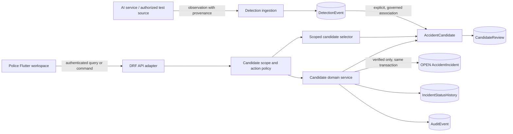
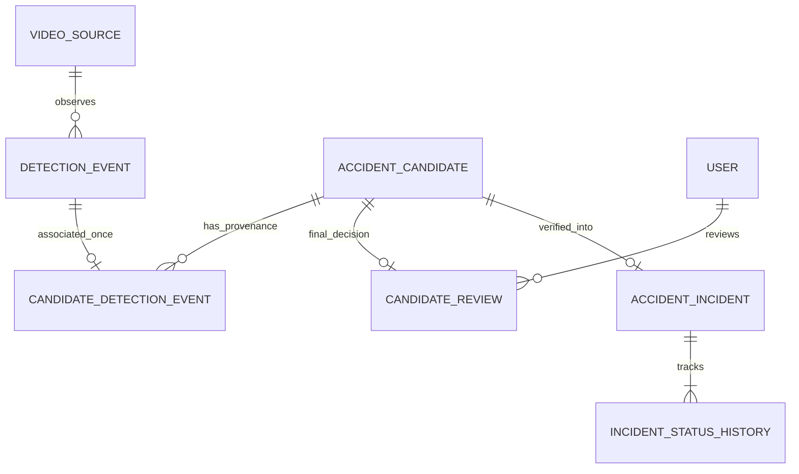

# Police Accident Review and Verification Architecture Blueprint

**Design status:** Proposed architecture for Phase 5E. It does not approve a runtime permission, close an OAD, or authorize implementation of blocked operations.

**Scope:** Police candidate review, controlled decision recording, atomic creation of one authoritative `OPEN` incident after verification, auditability, and Flutter integration. Hospital acknowledgement, dispatch simulation, external agency communication, and real emergency response are outside this milestone.

**Evidence convention:** **Approved** means the project owner explicitly approved the workflow slice on 2026-11-19. **Existing** describes code or database behavior found in this repository. **Recommendation** is a design proposal. **Unresolved** requires a recorded project or stakeholder decision before the relevant authority is enabled. Existing code is not evidence of policy approval.

## Executive Summary

ResQVision already has the central domain path needed for human verification. Django stores observations, candidates, final reviews, incidents, histories, and audit events separately. Its candidate service locks a candidate and, on verification, commits the final review, `VERIFIED` status, one linked `OPEN` incident, initial incident history, and success audit in one PostgreSQL transaction. Database uniqueness constraints and command identifiers protect against duplicate final decisions and incidents.

The approved workflow is Police-first: an appropriately authorized human Police reviewer makes the decision; AI confidence is not proof of an accident; only successful human verification creates an incident. A rejection creates no incident. An inconclusive review remains under review and creates no incident. This is a workflow approval, not a grant to every `POLICE` user.

The code is not ready to expose the Police workflow. Candidate queue, detail, association, and review API operations currently fail closed with policy-unavailable responses. Candidate authorization policy is absent, the API permission class denies candidate review, and reviewer identity, candidate/source/jurisdiction scope, assignment or queue ownership, permitted fields, evidence criteria, decision count, and verification rationale requirements remain unresolved. The source-to-Police jurisdiction relationship is not established by the current source ownership model.

**Readiness verdict:** The technical domain foundation is reusable, but privileged Phase 5E implementation and activation are **not policy-ready**. Record the OAD-012 reviewer and candidate-scope decisions and the event/grouping and safe-data prerequisites before enabling candidate access. The approved successful verification transaction can be reused; it should remain behind an explicit, fail-closed policy until those decisions are recorded.

This milestone ends at creation of the authoritative incident. That incident may become eligible for a separately governed Hospital request later. It must not trigger Hospital acknowledgement, dispatch, external notification, or any real emergency-service contact in Phase 5E.

## Current Architecture Assessment

| Area | Existing implementation | Assessment for Phase 5E |
|---|---|---|
| Backend | Django REST Framework API adapters, domain services, policy hooks, selectors, serializers, and centralized v1 routes. | Keep orchestration in API views and domain rules in services. Candidate routes are present as fail-closed placeholders. |
| Persistence | Django models and migrations target PostgreSQL. Candidate, review, incident, history, and event links have foreign keys, checks, and uniqueness constraints. | Current verification cardinality and transaction design fit one final decision and one incident per candidate. Assignment ownership and non-final review-attempt history are not represented. |
| Identity | Human JWT authentication resolves an active Django user. Machine actor identity is separate. Organization membership is a separate record from role groups. | Human identity and Police group membership are not sufficient candidate authority. AI_SERVICE is never a reviewer. |
| Existing incident authorization | Enabled incident reads are filtered through active target-organization membership and assignment scope. Selected assignment commands recheck target membership and state. Admin has no implicit global bypass. | Reuse these patterns, but do not reuse incident-assignment scope as candidate-review scope without an approved candidate policy. |
| Candidate authorization | Domain services accept injected authorization policy; missing policy fails closed. Candidate API operations currently return policy-unavailable. `HasCandidateReviewPermission` always denies. | Add explicit candidate actions and resource scope only after OAD-012 decisions. Do not unlock by role label or UI visibility. |
| AI and candidate intake | Detection ingestion stores an idempotent `DetectionEvent`. Candidate creation/association exists as a separate service. Ingestion does not automatically create or group candidates. Machine authentication and source authorization are not configured for a usable API workflow. | Define the authorized/synthetic event path and grouping policy. Do not silently infer that every event is a candidate or group similar events. |
| Flutter | Shared authenticated API client, role/membership models, dashboard, incident repository/controller, and read-only incident views exist. Police dashboard is an overview; no candidate review feature exists. | Add a candidate feature using the existing client and application patterns after backend contracts are approved. |
| External response | Response assignment and simulated notification concepts exist; creation/routing and several operations remain blocked. | Outside this blueprint's implementation scope. An `OPEN` incident alone does not create a Hospital request. |

The repository marks architecture and governance materials as revised drafts pending broader approval. The 2026-11-19 project-owner workflow approval settles the Police-first sequence and successful outcome, but does not approve the role/scope contract or any blocked route. See [governance overview](governance_overview.md), [candidate policy](candidate_review_verification_policy.md), and [workflow approval record](accident_verification_emergency_response_workflow.md).

## Existing Domain Capabilities

| Capability | Existing behavior | Reuse / limitation |
|---|---|---|
| Detection event | `DetectionEvent` records source, external event identity, service principal, model/version, detection/receipt time, outcome, optional confidence/digest, and metadata. `(video_source, external_event_id)` is unique. | Reuse provenance and duplicate-event protection. Detection is an observation, not verification. |
| Candidate | `AccidentCandidate` has `RECEIVED`, `UNDER_REVIEW`, `VERIFIED`, or `REJECTED` status and creation/update timestamps. | Reuse the aggregate. It has no Police organization, assigned reviewer, claim/lease, or candidate status-history table. |
| Event association | `CandidateDetectionEvent` associates an event and candidate, records method, optional linking user, and time. An event can be linked to at most one candidate. | Reuse the explicit association. Similar-event grouping and candidate merging are not implemented or approved. |
| Review decision | `CandidateReview` stores one final `VERIFIED` or `REJECTED` decision, reviewer, rationale, timestamp, and optional command ID. It is append-only. One final review per candidate and one use of each non-null command ID are constrained. Rejection rationale is required; verification rationale is nullable. | Reuse for the final decision. It does not model assignment, notes, a review attempt, inconclusive outcome, second reviewer, correction, or reopening. |
| Incident | `AccidentIncident` is linked to a candidate with a unique constraint and has `OPEN`, `RESPONSE_ACTIVE`, `RESOLVED`, or `CLOSED` status. | Reuse the existing authoritative record. No incident is created for an unverified/rejected candidate. |
| History and audit | `IncidentStatusHistory` records the initial `OPEN` state. `AuditEvent` records candidate creation, review start, final decision, and safe success/denial context through an allow-listed service. | Reuse current records. Candidate has no dedicated status-history entity; audit retention, reader access, and integrity governance remain open. |
| Domain commands | Candidate create/associate, queue/detail selectors, review start, verify, and reject functions exist in `backend/apps/incidents/services/candidates.py`. | Reuse services after policy and contract review. Service support does not mean a route or permission is available. |

Current `create_candidate` takes an explicitly selected event and does not implement similarity heuristics. The AI ingestion route only accepts and stores an event; it does not create a candidate. These are separate operations today. There is no public candidate-creation operation: the candidate collection view supports listing only, and is currently blocked. The service method is not an HTTP contract. An approved actor/source policy and grouping rule are prerequisites for an end-to-end workflow.

## Target System Architecture

The API adapter authenticates the caller, validates request shape, obtains the actor from the authenticated principal, delegates access filtering or a command to the backend, and maps results/errors to a versioned response. Candidate scope and permission policy must be checked server-side on every request. The service owns state-transition validation, locking, transaction boundaries, idempotency, domain records, and successful audit. Serializers validate syntax and bounded input only; they do not grant authority or decide transitions. Flutter renders backend results and never creates the incident or locally decides whether a candidate is verified.

Do not add a duplicate review or incident service. Add a reviewer-assignment model or candidate history only if the approved policy requires a capability that the current records cannot safely represent.

## Domain Responsibility and Entity Relationships

| Entity | Responsibility | Relationship and authority boundary |
|---|---|---|
| `DetectionEvent` | Immutable-enough record of what an authorized detector observed and its provenance. | Belongs to a `VideoSource`; can be associated with at most one candidate. Its confidence or `OBSERVATION`/`UNCERTAIN` outcome cannot establish a real accident. |
| `AccidentCandidate` | Review subject representing a possible accident. Owns the queryable candidate lifecycle status. | May have `CandidateDetectionEvent` links; review start/final decision services require at least one. Candidate status is not an incident status and does not imply Police assignment. |
| `CandidateReview` | The single final human decision on the current model. | References candidate and human reviewer. `VERIFIED` or `REJECTED`; append-only and unique per candidate. It is not an assignment record or a non-final review note. |
| `AccidentIncident` | Authoritative operational incident after successful Police verification. | References exactly one candidate; current database uniqueness allows at most one incident per candidate. Initial status is `OPEN`. |
| `IncidentStatusHistory` | Records incident status transitions. | References an incident; initial row is `None → OPEN` attributed to the verifier and command. Candidate review history is separate. |
| `AuditEvent` | Trace of consequential operations and safe denials. | Records actor, action, target, time/outcome and allow-listed context. It must not contain evidence bytes, secrets, or unrestricted rationale/media. |
| `OrganizationMembership` | Current relationship between a human account and an organization, with a role group and active/suspended/revoked state. | Establishes organization membership, not candidate jurisdiction, reviewer designation, or review assignment. |

The diagram shows the current cardinality, not a proposed reviewer assignment. An `UNDER_REVIEW` status currently means the candidate entered review; it does **not** identify who owns or may act on it.

## Police Review Workflow

1. An authorized or synthetic test source supplies an input. The AI service may produce a `DetectionEvent` with source and model provenance. Intake must not be described as a verified accident.
2. The backend creates or explicitly associates an `AccidentCandidate` under an approved event grouping rule. Current event ingestion does not do this automatically, and there is no public candidate-creation operation. Who or what is authorized to trigger materialization remains unresolved; do not assume every event becomes a candidate or expose an arbitrary client-controlled association.
3. A specifically authorized human Police reviewer obtains a scoped queue/detail view containing only approved fields. The user must have a current active human account and the approved reviewer grant and candidate scope.
4. The reviewer begins review only if the candidate is eligible. The backend records the transition to `UNDER_REVIEW` and a safe attributable audit record. Whether a specific reviewer owns the review is unresolved.
5. The reviewer submits a final `VERIFIED` or `REJECTED` decision with the approved rationale/checklist information. AI confidence is contextual evidence only.
6. On `VERIFIED`, the backend atomically records the final review, candidate status, exactly one linked `OPEN` incident, its initial status history, and the audit event.
7. On `REJECTED`, the backend records the final review and candidate state/audit, and creates no incident.
8. If the reviewer cannot reach a conclusion, the approved workflow says no incident is created and the candidate remains `UNDER_REVIEW`. The current domain has no `INCONCLUSIVE` decision or non-final review-attempt record. If the reviewer must persist an inconclusive outcome/rationale, approve its semantics and record shape before implementation; do not misuse the final `CandidateReview` record.

**Approved workflow semantics:** A human Police decision precedes incident creation; rejection/inconclusive outcomes create no incident; verification creates one `OPEN` incident; no AI actor can make the final decision.

**Not approved by that workflow:** The individual reviewer grant, reviewer assignment authority, one-versus-two reviewer count, review checklist, required verified rationale, candidate fields/evidence, and any verification threshold. These remain authorization and data-policy decisions, not implementation defaults.

## Candidate Lifecycle and State Transitions

| Transition | Current service behavior | Governance status and target rule |
|---|---|---|
| New → `RECEIVED` | Candidate creation creates `RECEIVED`; event association is explicit. | Existing code. Event grouping/creation trigger remains unresolved under OAD-015. |
| `RECEIVED` → `UNDER_REVIEW` | `begin_candidate_review` locks the candidate, requires event provenance, checks injected policy, updates status, and audits. | Transition fits the approved workflow. Reviewer cohort, resource scope, assignment/claim rule, and what concurrent starts mean still require approval. |
| `UNDER_REVIEW` → `VERIFIED` | `verify_candidate` creates final review, updates candidate, creates one `OPEN` incident/history and audit atomically. | Successful outcome approved. Action-specific identity/scope, checklist, rationale, and decision count remain unresolved. |
| `UNDER_REVIEW` → `REJECTED` | `reject_candidate` requires nonblank rationale, writes the final review/status/audit, and creates no incident. | Rejection as a no-incident outcome is approved. Who may reject and required decision criteria remain unresolved. |
| `UNDER_REVIEW` → inconclusive | No transition; candidate remains in current status if no final command is sent. | No incident is approved. Persisting an explicit non-final outcome is unsupported and requires an approved representation if required. |
| Final → reopened, dismissed, needs evidence, or merged | Not implemented. | Not part of this milestone. Do not add without an explicit decision on actor, state, audit, correction, visibility, retention, and incident impact. |

`VERIFIED` and `REJECTED` are terminal in the current model. A candidate must have associated event provenance before review or final decision. Adding candidate/evidence/media/location data to a reviewer view requires separate field-level approval; candidate access must not silently grant access to those domains.

## Authorization and Assignment Architecture

Authorization has four separate questions: **who is the principal**, **which organization membership is active**, **which candidate is in scope**, and **which action is granted**. A `POLICE` group label answers none of the final three by itself.

| Operation | Required authority shape | Existing protection / gap |
|---|---|---|
| List queue | Active human account, approved Police reviewer identity/cohort, candidate-level scope, and queue visibility grant. Apply the full scope before pagination. | Queue service calls `candidate.read_queue`; no configured policy or public API. It filters state and event presence but has no organization/source scope. |
| Read detail | Same reviewer/resource scope plus explicit permission for each returned field and association. | Domain method invokes `candidate.read`; candidate API returns 503. Evidence and location policies are separately blocked. |
| Start review | Explicit `candidate.review` grant, candidate scope, eligible state, provenance, and any approved ownership/claim rule. | Service checks an injected policy and state under row lock; API is blocked. `UNDER_REVIEW` does not encode reviewer ownership. |
| Verify | Explicit human Police final-verification grant over this candidate and approved checklist/preconditions. | Service calls `candidate.verify`; default/missing policy denies. No machine or Admin bypass is approved. |
| Reject | Explicit human Police final-rejection grant over this candidate, with required rationale. | Service calls `candidate.reject`; rejection rationale is checked. Authority remains unresolved. |
| Inconclusive | Explicit permission to record a non-final outcome, if the project requires persistence. | No command/decision representation exists. Do not make this a final review. |

**Organization scope:** The existing membership design correctly requires an active organization, active matching membership, and matching role group for enabled assignment operations. A candidate links to events and sources; a source may have an owner organization or an external owner reference. Neither relationship proves that the source owner is the Police jurisdiction or that every member of that Police organization is authorized for a candidate. Approve an explicit scope rule before deriving visibility from either relationship.

**Reviewer assignment:** No candidate reviewer assignment, queue coordinator, self-claim, lease timeout, or reassignment record exists. The architecture does not select one. The project must approve whether a designated coordinator assigns reviewers, a scoped reviewer cohort claims work, or another controlled model applies; also approve who may assign/reassign and what happens to an abandoned `UNDER_REVIEW` candidate. If no model is approved, keep candidate access and review disabled rather than allowing all Police users to browse or claim all candidates.

**Role boundaries:** Hospital has no candidate decision authority in the approved workflow. `ADMIN` has no assumed global candidate/reviewer access and is not an automatic substitute reviewer. AI_SERVICE may submit observations under a separately approved machine-auth/source contract but cannot read or decide candidates.

## Verification and Incident Creation Design

Reuse the existing candidate domain command and one PostgreSQL transaction as the authoritative verification boundary:

1. Require a human actor from the authenticated request, then check the approved candidate-specific `verify` policy and scope. Never accept a client-supplied reviewer identity.
2. Lock the candidate row, re-read its current state, require `UNDER_REVIEW` and event provenance, and validate the approved checklist and rationale requirements.
3. Check the command identifier. An identical retry by the same actor for the same candidate, decision, and normalized payload returns the original result; reusing it for different intent is a conflict.
4. Insert the one final `CandidateReview`, set candidate state to `VERIFIED`, create the linked `OPEN` `AccidentIncident`, insert initial `IncidentStatusHistory`, and append the successful audit event in the same transaction.
5. Return the committed authoritative result. If any insert, constraint, history, or audit write fails, roll back the decision and incident together. The client retries using the same command ID after an ambiguous transport/database failure.

The current service already performs these writes atomically, serializes decisions with `select_for_update`, and maps integrity conflicts to a resource conflict. `uq_review_candidate_final`, `uq_incident_candidate`, and unique non-null review command ID constraints are database backstops. The first valid committed final decision wins; a different concurrent command sees a stale state or uniqueness conflict and must not overwrite the first review. A retry must never create a second incident.

The approval is for one successful `OPEN` incident. It does not approve incident resolution/closure, a Hospital request, assignment creation, notification delivery, or a real response integration. Keep those operations in their existing blocked/unavailable state unless separately approved.

## Database Consistency and Concurrency Strategy

- Keep candidate, final review, and incident as distinct records. Do not collapse `VERIFIED` candidate status into incident status.
- Keep state, final review, initial incident history, and success audit inside the existing atomic service boundary. Keep denial audit separate after rollback so it survives a failed command.
- Use candidate row locks for review start, association and final decision; always recheck state after acquiring the lock. Preserve a consistent lock order if related rows are added.
- Let database uniqueness, not a preflight query alone, enforce one final review and one incident per candidate. Treat integrity errors as expected conflict paths and return a stable conflict response.
- Require stable command IDs for final operations. Store the command ID with the decision/history; compare actor, candidate, decision, and canonical request content on replay.
- Do not implement eventual consistency between candidate verification and incident creation. They are one transaction and one source of truth.
- No migration is required to reuse the existing one-final-decision/one-incident model. A migration may be required if governance approves reviewer assignments/claims, a durable non-final review attempt, multiple reviewers, mandatory verification rationale, or correction/reopen history. Design the exact constraint and data-retention semantics before adding schema.
- PostgreSQL locking behavior must be validated in database-backed tests; SQLite or mocks cannot establish row-lock race behavior. The repository already uses PostgreSQL for its database/test configuration.

## API Architecture and Interaction Contracts

The following are logical operations, not mandated URL names. Keep the public API versioned and use the repository's error envelope, authentication, throttling, pagination, request ID, and schema conventions.

| Operation | Contract responsibility |
|---|---|
| Materialize/associate candidate | After the actor/source and grouping policy are approved, accept only explicit event provenance, preserve the association method and actor, and apply source authorization and idempotency. This operation creates a review subject only; it cannot set `VERIFIED` or create an incident. The current backend has only a domain service, not a public API operation. |
| List review queue | Authenticate human; apply reviewer grant and candidate scope in the queryset before pagination; return only approved queue fields, opaque candidate IDs, current states, timestamps and safe provenance summaries. Do not return raw media, precise location, or unrestricted model metadata by default. |
| Read candidate | Recheck scope for each candidate; return the approved candidate facts and associated event summaries needed for review. A candidate's event link does not imply EvidenceAsset or location access. |
| Begin review | Accept command ID and any required concurrency/version token. Authorize and invoke the domain command; return resulting candidate state and whether it was an idempotent replay. |
| Record final decision | Accept a constrained decision (`VERIFIED` or `REJECTED`), required command ID, and approved rationale/checklist fields. The backend chooses the actor from authentication, checks current state and policy, and calls the existing final-decision service. A verified response returns the created incident summary; a rejected response returns the final candidate result and no incident. |
| Record inconclusive result, if approved | Use a separately defined non-final interaction contract and append-only record/audit behavior. Do not encode it as `REJECTED`, clear `UNDER_REVIEW`, or create an incident. |

List/detail and command paths must all re-evaluate policy; a previously loaded screen or membership snapshot is not a permission token. Scope filters must precede pagination to avoid cross-organization counts and row leakage. Use a safe 404 for inaccessible candidate resources after an approved policy is active; use the current stable policy-unavailable behavior while authority is unresolved. Map stale state/duplicate different intent to conflict, malformed input to validation errors, and database/service outage to a retryable server error without returning partial success.

Do not publish event evidence, location, or reviewer data fields in an API schema until field visibility is approved. Do not add a list-wide “Admin” route or a client-provided `reviewer_id`, organization ID, candidate status, incident ID, or authorization flag as trusted inputs.

## Flutter Application Architecture

The existing Flutter app has a shared authenticated API client and token/session flow, role and organization-membership data, a dashboard shell, and a read-only incident feature with repository/controller/presentation layers. The Police dashboard is currently an overview; candidate review is not implemented. Reuse these seams rather than adding authentication or a second network stack.

**Recommended placement:** Add a `features/candidates` feature with a repository over the shared authenticated client, a controller consistent with existing `ChangeNotifier` patterns, and queue/detail/review presentation. Link it from the Police workspace only after backend permissions and API contracts are active. A Police-looking screen, selected role, or local membership list is for navigation and context only; it never authorizes a request.

**Reviewer journey and client states:**

1. Sign in through the existing session gate. Load the existing authenticated user and memberships; show the candidate entry only when the backend capability is available for that session/context. Continue to rely on backend decisions for every operation.
2. Load a paginated queue. Provide explicit loading, empty, retryable network/server error, policy-unavailable, and stale/unauthorized states. Refresh on resume and after a command.
3. Open a candidate detail showing only backend-approved fields. Keep uncertain confidence visibly contextual; do not label the candidate as an incident before verification. Do not fetch evidence or location through a candidate detail shortcut.
4. Begin review if the backend returns the operation as available. Render the current backend state and any approved checklist. Do not allow simultaneous client state to manufacture a successful transition.
5. Submit a final decision with a generated stable command ID. Present a confirmation that names the consequence: verification creates an authoritative incident; rejection creates none. Capture only rationale fields approved by governance.
6. On success, render the backend's decision and incident result. On timeout, retry the same command ID. On conflict, refresh and explain that the candidate changed; do not offer a second decision. On policy-unavailable, keep the operation disabled and explain that the backend has not enabled it.

Do not duplicate candidate transition rules, infer assignments, trust a `POLICE` role string for access, cache sensitive detail beyond the needed screen lifetime, or include rationale/media/location in crash logs. Preserve keyboard/screen-reader labels and a deliberate confirmation for final decisions. Hospital views and dispatch controls do not belong in this feature.

## Audit and Traceability

| Action | Authoritative trace | Required trace fields / boundary |
|---|---|---|
| Candidate created / event associated | Existing candidate and association rows plus `AuditEvent`. | Candidate/event/source identifiers, association method, actor/service, timestamp and outcome. Do not imply that association verified an accident. |
| Review started | Candidate status plus `CANDIDATE_REVIEW_STARTED` audit event. | Actor, candidate, command/request ID, prior/resulting state, UTC time and safe outcome. No reviewer assignment ownership is currently stored. |
| Final verified/rejected | Append-only `CandidateReview`, candidate state, audit event; verification also writes incident and initial incident history. | Reviewer, decision, time, rationale in the protected review record, command ID, state, and incident ID on verification. Keep rationale out of general audit context. |
| Denied or stale action | Mutation services record safe denials after rollback where safely attributable. Candidate queue/detail currently fail closed at the API boundary; `get_candidate` does not currently append a read-denial audit. | Principal/action/resource type, request ID and stable safe reason code; avoid confirming resource existence while policy is unresolved. Add the approved read-denial audit behavior when candidate APIs are implemented. |
| Inconclusive review, if required | No current domain record. | Approve a non-final representation and rationale visibility/retention before implementing. The final-review table is not suitable. |

The current audit service allow-lists actions/context keys and supports successful and denied records. Keep current state, history and success audit in the same transaction. Do not log tokens, raw request bodies, media, signed URLs, credentials, precise coordinates, or unrestricted evidence text. Audit-reader authority, retention, tamper protection beyond the database model, and legal holds remain governance decisions.

## Failure Handling and Recovery

| Failure | Backend behavior | Flutter behavior / recovery |
|---|---|---|
| Missing/invalid human identity | Reject through existing authentication; do not construct a domain actor from request data. | Expire the session or request sign-in through existing session handling. |
| Authenticated but role/scope/action not granted | Deny; after a policy is approved, conceal out-of-scope detail consistently. While policy is unresolved, retain policy-unavailable behavior before candidate lookup. | Show unavailable/unauthorized state; do not fall back to broader role access. |
| Candidate state changed or another reviewer finalized | Recheck under lock; return conflict with no overwrite or duplicate incident. | Refresh queue/detail and explain the candidate is no longer actionable. |
| Same command retried with same intent | Return the original committed result and identify replay. | Reuse the same command ID after timeout/retry; avoid creating a new command for uncertain outcome. |
| Same command ID reused with different intent | Reject as idempotency conflict. | Stop retrying, refresh and surface a safe conflict. |
| Invalid/missing rationale or checklist data | Validation/domain error; no writes commit. | Preserve form input locally as permitted, show field-level errors, and do not imply a decision was saved. |
| Database, audit, or incident write fails | Roll back candidate decision, incident, history and success audit together; return retryable failure. | Keep candidate unresolved; retry with same command ID after connectivity returns. |
| Event/source unavailable or unauthorized | Fail closed and do not create a candidate from unapproved provenance. | Show no fabricated evidence; offer refresh only where allowed. |
| Request succeeds but response is lost | Domain transaction is already atomic and command ID resolves replay. | Retry the exact command; reconcile from returned backend state. |
| Flutter receives malformed/unknown response | Do not guess state or treat the candidate as decided. | Show a generic data error and allow a safe refresh. |

Never compensate by deleting a review or incident after commit. Corrections, reopen, or reversal require a separate approved and auditable operation.

## Security Considerations

- Preserve backend-as-authority: active human identity, exact action, candidate resource scope, current lifecycle state, and approved field scope are checked on every request.
- Keep identity, organization membership, reviewer designation, candidate assignment, and final-decision authority distinct. Do not grant all Police group members candidate access; do not grant Admin global access.
- Keep the `AI_SERVICE` principal separate and unable to read/review/verify/reject or create an incident through a client-supplied actor.
- Treat event provenance, evidence references, video, personal data, and location as sensitive. Candidate scope does not automatically grant media or location access. Do not equate camera coordinates with accident location.
- Preserve fail-closed 503 behavior for unresolved policy, safe 404 concealment for scoped missing/out-of-scope resources after a policy is configured, and consistent validation/conflict errors.
- Use bounded pagination, request throttling for commands, input-size limits, UUID command identifiers, and allow-listed audit context. Do not leak global candidate counts or queue contents across scope boundaries.
- Use synthetic or explicitly authorized test events. No live Police, Hospital, ambulance, or emergency endpoint may be contacted; no real dispatch is initiated.
- Keep account/group/organization management and audit browsing outside this feature. Review deployment secrets, transport security, session storage, and rate limits through the existing security baseline before shared use.

## Testing and Validation Strategy

Tests below are required when the approved implementation is undertaken; this blueprint task does not run them.

| Layer | Required cases |
|---|---|
| Domain | Legal transitions; no incident for rejection/inconclusive; exactly one `OPEN` incident on verification; missing provenance; rationale/checklist rules; immutable final decision; no AI/Admin bypass. |
| PostgreSQL integrity | Unique review and incident constraints; rollback if any write/audit step fails; same-command replay; different-intent command conflict; concurrent starts and competing verify/reject requests using real PostgreSQL row locks. |
| Authorization | Active/inactive account; Police group without approved reviewer grant; approved reviewer in and outside scope; wrong/inactive organization membership; source-owner versus Police-jurisdiction mismatch; Admin and Hospital denied; machine actor denied; no queue counts or detail leakage. |
| API | Authenticated queue/detail/start/final-decision contracts; scope-before-pagination; policy-unavailable behavior; safe 404; validation, 409 conflict, rate-limit and server-failure envelopes; request IDs; no unauthorized fields. |
| Audit | Successful and denied actions; actor, timestamp, target, command and outcome; transactional success audit; denial survives rollback; rationale/media/token redaction; append-only final review. |
| Flutter unit/widget | Queue loading/empty/error/unavailable states; detail field minimization; no client authority from role label; final-decision confirmation; command ID reuse on retry; conflict refresh; accessibility. |
| Flutter integration | Authenticated Police journey against a controlled backend; unauthorized Police, Admin, Hospital and out-of-scope reviewer journeys; lost-response replay; no Hospital/dispatch call. Use synthetic or expressly authorized test events. |
| End to end | Synthetic event to candidate to authorized reviewer decision; verified outcome creates one visible scoped incident; rejected/inconclusive outcome creates none; denial, concurrency, retry and audit assertions; configuration check confirms no external emergency egress. |

Relevant existing implementation evidence includes `backend/tests/test_domain_services.py`, `backend/apps/incidents/tests/test_candidate_incident_models.py`, `backend/api/tests/test_api.py`, the Flutter incident repository/widget tests, and the current dashboard integration test. They should be extended only after approval of the corresponding contracts; their presence is not proof that the new feature is authorized or fully covered.

## Implementation Dependencies

1. Record the reviewer cohort/identity and candidate resource scope, including how source, jurisdiction, and any multiple Police organizations map to candidate visibility.
2. Decide assignment/claim ownership, review abandonment/reassignment, and one-versus-multiple final reviewer behavior. If a reviewer assignment or durable attempt is required, define its model/history and migration before API work.
3. Approve the verification checklist, evidence/provenance sufficiency, required fields visible to Police, rationale requirements for both final outcomes, and inconclusive outcome recording. Define whether verified rationale becomes mandatory before changing the nullable field/constraint.
4. Resolve the controlled test/intake path, source owner authority, AI_SERVICE machine authentication if machine intake is needed, event identity, candidate creation trigger, and OAD-015 grouping/duplicate behavior. Current ingestion alone produces no candidate and the machine API fails closed while unconfigured.
5. Approve API error, pagination, command-ID, audit, and retention contracts. Do not expose audit history or increase evidence/location access by implication.
6. Implement the backend authorization/selectors and API over the existing domain service, then the Flutter Police experience, then cross-layer security validation. Keep the candidate actions disabled until the policy is configured.
7. Defer Hospital request creation/routing, acknowledgement, dispatch simulation, and all external integrations to their separately governed milestone. The verified incident is the Phase 5E output.

## Unresolved Governance Decisions

| Decision | Current status | Required disposition before enabling affected capability |
|---|---|---|
| Police-first role class and incident outcome | **Approved** by project owner on 2026-11-19: specifically authorized human Police reviewer first; successful verification yields one `OPEN` incident. | Preserve as scoped workflow approval; do not turn into a broad role grant. |
| Reviewer identity/group and action grants | **Unresolved** (OAD-012). | Name the approved cohort or delegated grant mechanism; separately define queue read, detail read, begin review, verify, reject, and any inconclusive action. |
| Candidate scope/jurisdiction | **Unresolved** (OAD-012; related source authority OAD-019). | Define candidate/source/organization relationships and explicit cross-organization rules. Source owner or membership must not be guessed to equal jurisdiction. |
| Review assignment/claim/abandonment | **Unresolved** (OAD-012). | Choose assignment/claim/no-assignment model, authority, concurrency, reassignment, expiry and audit. No reviewer assignment authority is assumed. |
| Reviewer count and conflict rule | One final decision is implemented; multi-review is **unresolved** (OAD-012). | Confirm one reviewer or independent second review and whether first committed result is final. Schema/service constraints may differ. |
| Checklist, evidence, and decision rationale | **Unresolved** (OAD-012; evidence access OAD-002/014/016). Rejection rationale is required in code; verification rationale is optional. | Approve evidence sufficiency, allowed fields/media, rationale requirements, and handling for missing/conflicting evidence. |
| Inconclusive recording | Workflow outcome is approved as no incident and continued `UNDER_REVIEW`; durable outcome representation is **unresolved/not implemented**. | Decide if an attributed non-final decision/rationale must persist and approve its protected record and retention. |
| Candidate creation/grouping | Explicit event association exists; automatic intake/grouping/merge is **unresolved** (OAD-015). | Approve candidate creation trigger, grouping key/window, duplicates, and provenance preservation. |
| Source consent and machine authentication | **Unresolved** (OAD-017/019); machine authenticator/source registry routes are not configured. | Approve synthetic/test source or source authorization and machine identity before using live service intake. |
| Evidence/location exposure | **Unresolved** (OAD-001/002/014/016/020) and APIs blocked. | Keep out of the review view unless role-specific fields, precision, retrieval and retention are separately approved. |
| Audit access and retention | **Unresolved**. | Approve retention/legal hold, audit reader scope and integrity/backup policy; do not add broad audit access in this feature. |
| Hospital response request | Workflow order after incident is approved; target, routing, record mapping, retry and notification contract remain unresolved (OAD-013/018/021). | Separate milestone; do not couple request creation to Phase 5E verification. |
| Incident resolution/closure and real dispatch | Authority unresolved; real emergency response is prohibited for the academic prototype. | Keep blocked; no dispatch or external contact. |

Preserve all existing OAD identifiers and status values. Record any decision as an appropriately dated OAD amendment or approved ADR; this blueprint is not an OAD approval.

## Recommended Implementation Sequence

1. **Governance gate.** Close the OAD-012 reviewer/scope/assignment/decision checklist and approve allowed review fields. Resolve whether a durable inconclusive record or any schema extension is needed. Keep privileged candidate routes blocked until this gate is documented.
2. **Domain/data foundations.** Confirm candidate intake and event grouping for synthetic or expressly authorized events. Reuse `DetectionEvent`, candidate association, final review, incident and existing uniqueness constraints. Add only schema changes required by approved assignment/history/rationale semantics.
3. **Authorization and candidate access.** Implement candidate-specific policy operations and scoped queue/detail selectors; apply scope before pagination; test direct object access and negative role/scope cases. Keep evidence/location separately blocked.
4. **Review and decision operations.** Expose begin-review and approved final/non-final commands through thin API adapters; require command IDs; preserve current atomic transaction, audit, stale-state conflict, and denial behavior.
5. **Verified incident creation.** Reuse and validate the current atomic service path, including exactly one `OPEN` incident and initial history only on verification. Confirm replay, rollback, and PostgreSQL concurrency behavior.
6. **Flutter Police review experience.** Add queue/detail/review presentation through the existing authenticated client and feature architecture. Display only approved fields and backend states; implement safe retry and conflict refresh.
7. **Cross-layer integration/security validation.** Validate scoped reads, unauthorized roles, same-organization boundaries, source/jurisdiction mismatches, concurrent decisions, retry/rollback, audit redaction, and synthetic-only operation. Confirm no Hospital or emergency integration is called.
8. **Separate later response milestone.** Only after target/routing and response governance are approved, design incident-linked Hospital request creation and simulated acknowledgement/dispatch/status. This is excluded from Phase 5E.

## Phase 5E Completion Criteria

- Reviewer identity/cohort, candidate scope, assignment or claim semantics, decision count, permitted fields, checklist, rationale, and inconclusive handling are recorded as approved decisions; OAD statuses are updated only by their decision owners.
- No candidate queue/detail/final-decision action is enabled by `POLICE` membership alone. Admin, Hospital, AI_SERVICE, inactive users, and out-of-scope Police users fail closed.
- Authorized candidate access is scope-filtered before pagination, and detail responses disclose only approved fields. Evidence and location remain subject to their separate policies.
- A candidate with validated event provenance can move only through approved state transitions. An authorized final verification creates exactly one linked `OPEN` incident, initial history, candidate review, status update, and audit in one transaction.
- Rejection creates no incident. An inconclusive review creates no incident and remains under review; if it must be durably recorded, the approved non-final record is immutable and attributable.
- PostgreSQL constraints, row locks, stable command IDs, and replay handling prevent duplicate/conflicting decisions and duplicate incidents. Failed writes leave no partial authoritative result; denial audit remains safe and traceable.
- The Flutter Police workflow consumes backend-authorized state, handles empty/loading/error/unavailable/conflict/retry outcomes, uses the same command ID for retries, and creates no local business authority.
- Domain, PostgreSQL concurrency, authorization, API, audit, Flutter, and end-to-end requirements in the testing strategy pass against synthetic or expressly authorized test events.
- No Hospital acknowledgement, ambulance dispatch, real agency notification, external emergency-service contact, unapproved media/location access, or real response occurs in Phase 5E.
- Architecture links resolve, documentation diff has no whitespace errors, and no application code, models, migrations, APIs, permissions, or tests were modified as part of this blueprint task.

## References

- [Architecture index](../README.md), [system architecture](../system_architecture.md), [component architecture](../component_architecture.md), [trust boundaries](../trust_boundaries.md), and [data flow](../data_flow.md).
- [Domain governance overview](governance_overview.md), [domain principles](domain_principles.md), [candidate review policy](candidate_review_verification_policy.md), [incident lifecycle policy](incident_lifecycle_policy.md), and [approved workflow record](accident_verification_emergency_response_workflow.md).
- [Open architecture decisions](../open_architecture_decisions.md), [domain governance decision register](../decisions/domain_governance_decision_register.md), [authorization matrix](../security/authorization_matrix.md), and [implementation readiness](implementation_readiness.md).
- [Transaction and integrity design](../../database_design/transaction_and_integrity_design.md), [database schema specification](../../database_design/database_schema_specification.md), [API authorization contract](../../api_documentation/authorization_contract.md), and [security baseline](../../security/security_baseline.md).
- Backend evidence: `backend/apps/detection/models.py`, `backend/apps/detection/services/ingestion.py`, `backend/apps/incidents/models.py`, `backend/apps/incidents/services/candidates.py`, `backend/api/v1/{views,selectors,policies,permissions}.py`, and `backend/apps/audit/{models.py,services/events.py}`.
- Flutter evidence: `mobile_app/lib/app/`, `mobile_app/lib/features/dashboard/`, `mobile_app/lib/features/incidents/`, and [mobile architecture](../../../mobile_app/docs/architecture.md).
